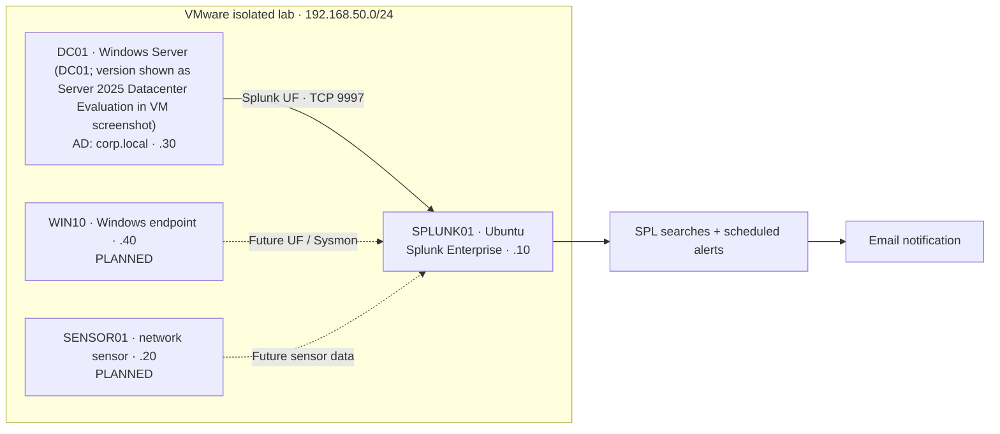

# SPLINT-R | Home SOC & Detection Engineering Lab

> **Project status (Nov 1, 2026):** Active solo lab build. Splunk on Ubuntu and DC01 are running, and four DC01 sourcetypes (including Sysmon XML, Security, System, Application) were verified in Splunk. The manual encoded PowerShell positive test returned a matching event. A scheduled SPLINT-R-002 alert was saved and its trigger history shows multiple triggers. The manual Atomic Red Team T1059.001 Test #17 execution was captured in Sysmon and matched the revised SPL search; the newest automatic-alert-to-event association remains unverified. Detection files here are portable reconstructions, not exports from Splunk; compare each one against the saved search before presenting it as the exact live configuration.

SPLINT-R is a self-hosted security operations lab built to practice **telemetry engineering, detection logic, alerting, and investigation documentation**. It runs in an isolated VMware network with a Windows Server Active Directory host sending security logs to an Ubuntu-based Splunk instance.

**The problem:** SOC analysts need to distinguish meaningful behavior from routine noise. This lab starts with a measurable detection hypothesis, collects evidence, simulates activity in a safe environment, and evaluates whether an alert can be produced and investigated.

## At a glance

| Area | Implementation | Status |
| --- | --- | --- |
| Hypervisor / network | VMware; lab subnet `192.168.50.0/24` | Working in current session |
| SIEM | Ubuntu `SPLUNK01`, Splunk Enterprise, `192.168.50.10` | Verified running Nov 1 |
| Identity environment | Windows Server (DC01; version shown as Server 2025 Datacenter Evaluation in VM screenshot) `DC01`, `corp.local`, `192.168.50.30` | Verified running Nov 1 |
| Forwarding | DC01 Windows event data reaches Splunk; receiver previously configured on TCP 9997 | Ingestion verified Nov 1 |
| Detection 001 | ≥5 failed logons in 3 minutes, Event ID 4625 | **Lab behavior demonstrated Oct 11**; portable SPL needs revalidation |
| Alerting | Scheduled Splunk alert; email action | Previously triggered / email delivered |
| Sysmon | Process, registry, file, DNS and limited network telemetry | **Verified Nov 1** |
| Detection 002 | Encoded PowerShell search; scheduled alert | **Manual tests and Atomic `-e` search hits verified; alert triggers recorded** |
| Detection 003 | Privileged group membership change | **Draft only; untested** |
| Atomic Red Team | T1059.001 Test #17 | **Official test manually executed; Sysmon and revised SPL search verified** (framework-driven execution not demonstrated) |
| Endpoint and network sensor | WIN10 `192.168.50.40`; SENSOR01 `192.168.50.20` | Proposed / not verified |
| Dashboards and screenshots | SOC overview and evidence set | Pending |

**Scope statement:** This is a home lab, not a production SOC and not a claim that all listed roadmap tools have been deployed.

## Architecture



Solid connections represent the earlier working workflow; dotted connections represent work not yet verified or implemented. Network address endings are shorthand for `192.168.50.x`.

## Detection coverage

| ID | Use case | Data source | ATT&CK | Evidence | State |
| --- | --- | --- | --- | --- | --- |
| [001](detections/SPLINT-R-001-failed-logons.md) | Failed-logon burst | Security `4625` | [T1110](https://attack.mitre.org/techniques/T1110/) | Alert and email observed in earlier lab session | **Previously demonstrated; query recreation unverified** |
| [002](detections/SPLINT-R-002-encoded-powershell.md) | PowerShell with encoded-command switch | Sysmon `1` | [T1059.001](https://attack.mitre.org/techniques/T1059/001/) | Manual and Atomic `-e` event hits; scheduled triggers observed | **Search validated; latest scheduled trigger association pending** |
| [003](detections/drafts/SPLINT-R-003-privileged-group-change.md) | Privileged group membership change | Security `4728/4732/4756` | [T1098.007](https://attack.mitre.org/techniques/T1098/007/) | None yet | **Draft only** |

Do **not** count the draft privileged-group search as a tested detection. The official Atomic Red Team Test #17 was run **manually**, and its telemetry was verified in Splunk. The framework module is installed, but the test was not run via `Invoke-AtomicTest`. The updated SPL search matches `-e`; broader detection coverage and exact scheduled-alert-to-event association still need review. The strongest portfolio presentation will show before/after evidence, detection logic, false-positive considerations, and a concrete investigation path.

## Demonstrated workflow

1. **Collect:** Windows Security event data is ingested from `DC01` into Splunk.
2. **Detect:** A scheduled search identifies a burst of failed logons (Event ID 4625).
3. **Notify:** Splunk produces a triggered alert and delivers an email notification.
4. **Investigate:** Pivot on host, attempted username, source address, time range, and subsequent successful logons (4624). This investigation workflow is suggested; do not represent it as completed until evidenced.
5. **Tune:** Evaluate thresholds and benign failure causes before enabling persistent alerting.

## Reproduce the lab

See [Setup & verification](docs/SETUP.md), [Detection 001](detections/SPLINT-R-001-failed-logons.md), and the [demo runbook](docs/DEMO.md). The example Splunk configuration under `config/examples/` is sanitized; it is *not* a backup of the original VM configuration.

### Fast ingestion health check

```spl
index=main earliest=-24h
| stats count as events latest(_time) as last_seen by host sourcetype
| convert ctime(last_seen)
| sort -events
```

Expected: recent Windows events from `DC01` **once the VMs and forwarding pipeline are running**. If empty, expand to `earliest=-30d` to distinguish a stopped system from a missing history. Confirm the actual index and source type in your environment.

## Evidence gallery

Verified screenshot evidence is indexed in [`evidence/screenshots/`](evidence/screenshots/README.md). Additional screenshots to collect:

- Splunk recent Windows Security events (with host, sourcetype, timestamp visible)
- The 4625 detection returning results
- Splunk Triggered Alerts showing SPLINT-R-001
- Email notification with account details and addresses redacted
- A basic SOC overview dashboard
- Sysmon process events (verified Nov 1)
- Post-update `-e` scheduled alert View Results showing the matching event (not yet established)

> Avoid uploading screenshots of passwords, SMTP settings, API tokens, personal email addresses, real usernames, session cookies, or raw event exports. Review your browser address bar and Splunk search history too.

## Project milestones

- [x] VMware network, Ubuntu/Splunk, Windows Server DC initially configured
- [x] Windows Security logs ingested; Event 4625 observed (last recorded Oct 2026)
- [x] Failed-logon alert and email notification demonstrated in the lab
- [x] Re-verify DC01 Windows ingestion and Sysmon event extraction on Nov 1
- [x] Develop and manually test encoded PowerShell rule; record a triggered scheduled alert
- [ ] Review SPLINT-R-001 portable recreation against current saved configuration
- [ ] Verify latest scheduled alert View Results corresponds to the **post-update `-e`** test
- [x] Execute reviewed Atomic Red Team T1059.001 Test #17 manually, identify `-e` coverage gap, and validate improved SPL search
- [ ] Validate another additional detection with a repeatable test procedure
- [ ] Document an end-to-end triage case and false positives
- [ ] Build and capture an operational dashboard
- [x] Add screenshots of manual and Atomic `-e` process events, revised SPL search, and triggered alert history
- [ ] Add additional screenshots and end-to-end case evidence
- [ ] Publish this repository and link it on a resume / LinkedIn profile

Longer-term ideas—second endpoint, network sensor, Zeek/Suricata, osquery, Velociraptor, TheHive/Cortex, CALDERA and cloud logs—are recorded in [ROADMAP](docs/ROADMAP.md), not represented as complete.

## What I learned / what I can explain

- How Windows telemetry reaches a SIEM from a forwarder
- How to test an SPL hypothesis against real lab-generated events
- How an alert differs from an investigation and from confirmed compromise
- Why overlapping alert windows, host/account/source grouping, and notification throttling matter
- How to assess detection gaps, false positives, and evidence quality

## Security and usage

This project is intended for an isolated, personally controlled lab. Only test accounts and systems you own or are permitted to administer. No real credentials, Splunk authentication material, SMTP app passwords, company data, or unredacted raw events should enter Git history. Read [SECURITY.md](SECURITY.md) before publishing.

## References

- [Splunk: monitor Windows Event Logs](https://help.splunk.com/en/splunk-enterprise/get-started/get-data-in/9.4/get-windows-data/monitor-windows-event-log-data-with-splunk-enterprise)
- [Splunk: scheduled alerts](https://help.splunk.com/en/splunk-enterprise/alert-and-respond/alerting-manual/10.6/create-alerts/create-scheduled-alerts)
- [Microsoft: Sysmon](https://learn.microsoft.com/en-us/sysinternals/downloads/sysmon)
- [MITRE ATT&CK: T1110](https://attack.mitre.org/techniques/T1110/)
